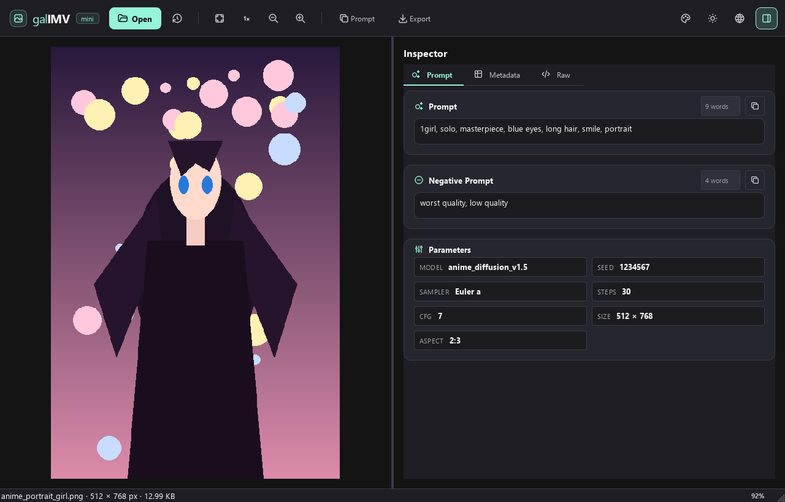
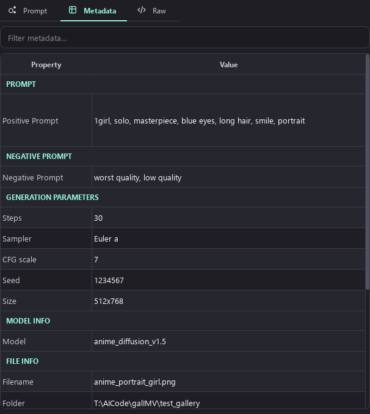
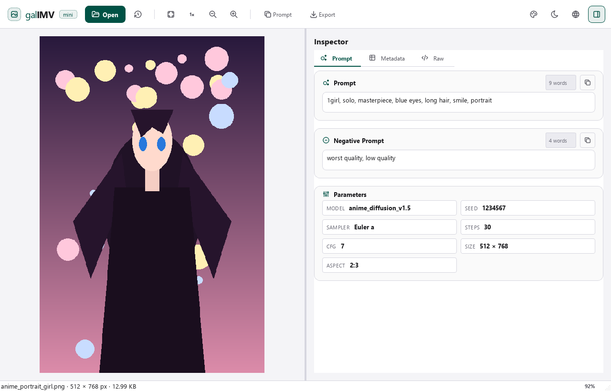

<h1 align="center">galIMV Image Metadata Viewer</h1>

<p align="center">mini · Single-image inspector · Python / PyQt6<br /><strong>English</strong> · <a href="README.ru.md">Русский</a></p>



<p align="center">
  
  
  
  
  
</p>
<p align="center">
  
  
  
</p>

Open an AI image and read its prompt, generation parameters, and embedded metadata in one window. The image canvas and inspector stay side by side so you can check details and copy what you need.

## Start with an image

Download the [Windows x64 release](https://github.com/LeonWGal/galIMVmini/releases/tag/v1.2.0). Choose the standalone EXE or extract the portable ZIP; Python is included. For source code, see [Run from source](#run-from-source).

1. Open the standalone EXE, or open `galIMVmini.exe` from the portable folder. In the project, it is in `dist/galIMVmini/`. The Python runtime is included.
2. Select **Open** (`Ctrl+O`) or drop an image onto the canvas. Its preview and metadata appear together.
3. Select **Prompt**, **Metadata**, or **Raw** to inspect the details you need.

## Inspect without switching windows

Use the workspace to:

- **Check the image.** Zoom, pan, fit to the window, or view it fullscreen.
- **Read structured details.** Inspect prompts, generation parameters, aspect ratio, metadata categories, and raw text.
- **Keep the result.** Copy a prompt or export metadata as TXT, Markdown, JSON, or CSV.

## Look beyond the prompt

The inspector separates readable prompts from metadata categories and raw content. Generation settings and extension fields appear when the file contains them; camera images also provide EXIF metadata.

<p align="center"></p>

The parser reads Automatic1111-style parameters, ComfyUI graphs, NovelAI JSON, PNG text, EXIF, and companion `.txt` files. Available fields depend on what the image contains.

## Keep the interface consistent

Choose a dark or light theme and one of 12 Lobe accents. The application icon follows the selected accent. The contour mark, typography, and Tabler icons match galIMV; mini uses opaque surfaces and a compact single-image layout.



## Useful shortcuts

These shortcuts cover the main actions:

| Shortcut | Action |
| --- | --- |
| `Ctrl+O` | Open an image |
| `Ctrl+H` | Open recent files |
| `Ctrl+C` | Copy the prompt |
| `Ctrl+E` | Export metadata |
| `0 / 1` | Fit the image / show 100% |
| `I / F11` | Toggle the inspector / fullscreen |

## Run from source

You need Python 3; the application is tested with Python 3.14. `requirements.txt` lists PyQt6, Pillow, and pyperclip.

From the project folder, run:

```powershell
python -m venv .venv
.venv\Scripts\python.exe -m pip install -r requirements.txt
.venv\Scripts\python.exe main.py
```

To build a portable directory, install PyInstaller in that environment and run:

```powershell
.venv\Scripts\python.exe -m pip install pyinstaller
.venv\Scripts\python.exe build_exe.py
```

The result is in `dist/galIMVmini/`.

## Files and documentation

The application reads local images. Settings and cache are in `%LOCALAPPDATA%/LeonWGal/galIMVmini`; temporary files are in `%TEMP%/LeonWGal/galIMVmini`.

See the [shared interface guide](docs/shared-ui.md) for icons, palettes, component sizes, and checks.

Open a test image and confirm that its preview and metadata appear in the inspector. Then select your theme and interface language.

---

**LeonWGal** · [MIT license](LICENSE)
