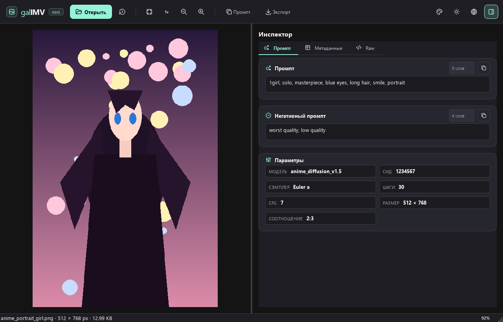
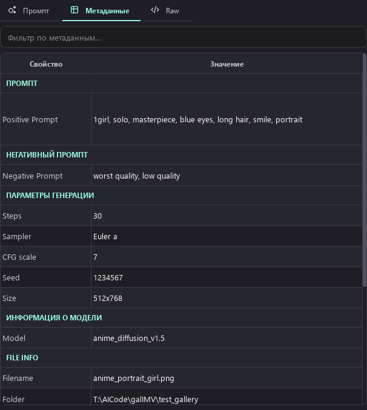
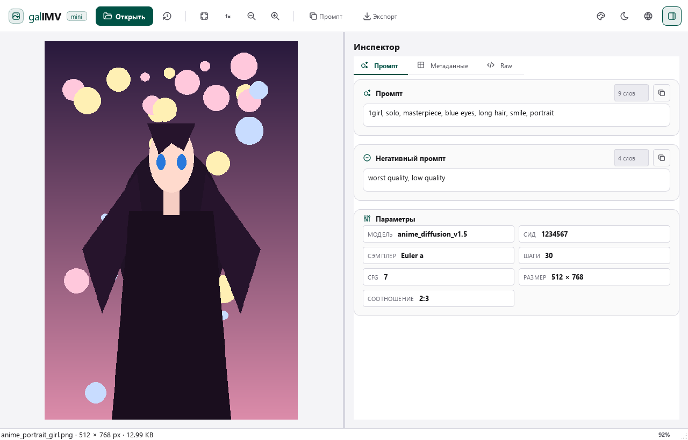

<h1 align="center">galIMV Image Metadata Viewer</h1>

<p align="center">mini · Инспектор одного изображения · Python / PyQt6<br /><a href="README.md">English</a> · <strong>Русский</strong></p>



<p align="center">
  
  
  
  
  
</p>
<p align="center">
  
  
  
</p>

Откройте AI-изображение и изучите его промпт, параметры генерации и встроенные метаданные в одном окне. Холст и инспектор расположены рядом: проверяйте детали и копируйте нужные значения.

[Windows x64 · v1.2.0](https://github.com/LeonWGal/galIMVmini/releases/tag/v1.2.0)

## Начните с изображения

Нужна подготовленная Windows-сборка. Для исходников см. [инструкцию запуска](#запустите-из-исходников).

1. Откройте `galIMVmini.exe` из portable-папки. В проекте она находится в `dist/galIMVmini/`. Python входит в комплект.
2. Нажмите **Открыть** (`Ctrl+O`) или перетащите изображение на холст. Превью и метаданные появятся рядом.
3. Выберите вкладку **Промпт**, **Метаданные** или **Исходные данные**, чтобы изучить нужные данные.

## Проверяйте всё в одном окне

Основные действия:

- **Рассматривайте изображение.** Меняйте масштаб, перемещайте холст и открывайте полноэкранный просмотр.
- **Читайте структурированные данные.** Изучайте промпты, параметры, соотношение сторон, категории метаданных и исходный текст.
- **Сохраняйте результат.** Копируйте промпт или экспортируйте метаданные в TXT, Markdown, JSON и CSV.

## Посмотрите дальше промпта

Инспектор разделяет читаемые промпты, категории метаданных и исходное содержимое. Параметры генерации и расширений появляются, когда они есть в файле; для фотографий доступны данные EXIF.

<p align="center"></p>

Парсер читает параметры Automatic1111, графы ComfyUI, JSON NovelAI, текст PNG, EXIF и соседние `.txt`-файлы. Набор полей зависит от содержимого изображения.

## Выберите общее оформление

Светлая и тёмная темы используют 12 акцентов Lobe. Иконка программы меняет цвет вместе с акцентом. Контурный знак, типографика и иконки Tabler совпадают с galIMV; mini использует непрозрачные поверхности и компактный режим одного изображения.



## Полезные сочетания

Основные сочетания для работы с клавиатуры:

| Сочетание | Действие |
| --- | --- |
| `Ctrl+O` | Открыть изображение |
| `Ctrl+H` | Открыть недавние файлы |
| `Ctrl+C` | Скопировать промпт |
| `Ctrl+E` | Экспортировать метаданные |
| `0 / 1` | Вписать изображение / показать 100% |
| `I / F11` | Показать инспектор / включить полный экран |

## Запустите из исходников

Нужен Python 3; приложение проверено с Python 3.14. Зависимости PyQt6, Pillow и pyperclip перечислены в `requirements.txt`.

Из папки проекта выполните:

```powershell
python -m venv .venv
.venv\Scripts\python.exe -m pip install -r requirements.txt
.venv\Scripts\python.exe main.py
```

Чтобы собрать portable-папку, установите PyInstaller в это окружение и выполните:

```powershell
.venv\Scripts\python.exe -m pip install pyinstaller
.venv\Scripts\python.exe build_exe.py
```

Результат находится в `dist/galIMVmini/`.

## Файлы и документация

Программа читает локальные изображения. Настройки и кэш находятся в `%LOCALAPPDATA%/LeonWGal/galIMVmini`, временные файлы — в `%TEMP%/LeonWGal/galIMVmini`.

См. [справочник общего интерфейса](docs/shared-ui.md): иконки, палитры, размеры элементов и проверки.

Откройте тестовое изображение и убедитесь, что превью и его метаданные появились в инспекторе. Затем выберите тему и язык интерфейса.

---

**LeonWGal** · [Лицензия MIT](LICENSE)
